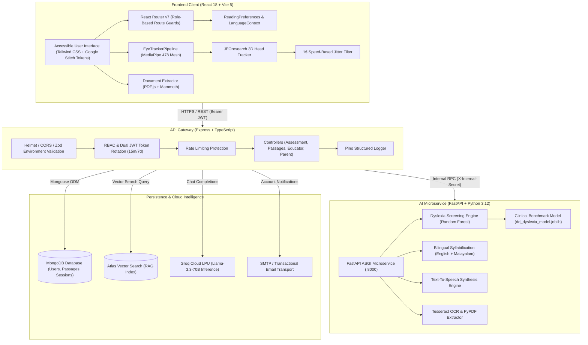

<div align="center">

# 📖 ReadEase

### **Empowering Neurodivergent & Dyslexic Readers through Cognitive-First Assistive Intelligence**

[](https://www.typescriptlang.org/)
[](https://react.dev/)
[](https://vitejs.dev/)
[](https://nodejs.org/)
[](https://expressjs.com/)
[](https://fastapi.tiangolo.com/)
[](https://www.python.org/)
[](https://www.mongodb.com/)
[](https://tailwindcss.com/)
[](https://www.w3.org/WAI/standards-guidelines/wcag/)
[](https://opensource.org/licenses/MIT)

<p align="center">
  <a href="#-overview">Overview</a> •
  <a href="#-use-case-architecture">Use Cases</a> •
  <a href="#-key-features">Key Features</a> •
  <a href="#-system-architecture">Architecture</a> •
  <a href="#-tech-stack">Tech Stack</a> •
  <a href="#-configuration-and-execution-guide">Quick Start</a> •
  <a href="#-test-accounts">Test Accounts</a> •
  <a href="#-api-reference">API Reference</a> •
  <a href="#-datasets-and-benchmarks">Datasets</a> •
  <a href="#-academic-references--citations">Citations</a> •
  <a href="#-license">License</a>
</p>

---


</div>

---

## 🌟 Overview

**ReadEase** is an enterprise-grade, accessible reading and assistive learning ecosystem designed to eliminate cognitive, visual, and phonological barriers for individuals with **dyslexia**, **ADHD**, **visual stress (Meares-Irlen syndrome)**, and broader neurodivergent reading profiles.

Traditional educational reading tools and digital documents assume typical oculomotor control and uniform phonological processing. For neurodivergent readers, this creates severe friction:

- **Visual Crowding & Line Skipping**: Unstable saccadic trajectories cause readers to skip lines or lose their place.
- **Phonemic Decoding Fatigue**: Difficulty converting graphemes to phonemes leads to slow comprehension and reader anxiety.
- **High-Contrast Glare**: Harsh black-on-white text triggers visual stress, word distortion, and eye strain.
- **Prohibitive Assessment Barriers**: Clinical dyslexia screening typically requires expensive infrared hardware (e.g. Tobii eye trackers costing thousands of dollars) and specialized neuropsychologists.

**ReadEase bridges this divide** by combining:

1. **Zero-Hardware Webcam Reading Assessments** using MediaPipe FaceMesh (478 landmarks) and 3D Head Pose tracking.
2. **Machine Learning Dyslexia Screening** calibrated against the landmark 4,298-subject **HSE University DD-main** clinical benchmark.
3. **Real-Time Cognitive Typography** (dynamic Bionic Reading bolding, research-backed dyslexia typefaces, interactive reading rulers, and warm contrast filters).
4. **Bilingual Phonemic Assistance** for both **English** and **Malayalam (മലയാളം)** with automated syllable decomposition and synchronized speech playback.
5. **A 5-Role Collaborative Portal Ecosystem** connecting Students, Teachers, Special Educators, Parents, and Administrators.

---

## 🎯 Use Case Architecture

ReadEase caters to five distinct stakeholders through dedicated, accessible role portals:

```mermaid
graph TD
    User([ReadEase Users]) --> Student[🎒 Student / Reader]
    User --> Teacher[👩‍🏫 Classroom Teacher]
    User --> Educator[🩺 Special Educator]
    User --> Parent[👨‍👩‍👧 Parent / Guardian]
    User --> Admin[⚙️ System Administrator]

    Student --> S1[Tactile Reading Studio & Bionic Text]
    Student --> S2[Zero-Hardware Webcam Assessment]
    Student --> S3[Interactive Reading Ruler & Color Tints]
    Student --> S4[Reading Streaks & Achievement Badges]

    Teacher --> T1[Class Roster Management & Cohort Limits]
    Teacher --> T2[Reading Passage Assignments]
    Teacher --> T3[WPM, Accuracy & Saccadic Fluency Reports]
    Teacher --> T4[Invite & Collaborate with Special Educators]

    Educator --> E1[IEP Tracking & Accommodation Presets]
    Educator --> E2[Clinical Dyslexia Screening Analytics]
    Educator --> E3[Bilingual Phonemic Breakdown Tools]
    Educator --> E4[Session Notes & Intervention Audits]

    Parent --> P1[Longitudinal Reading Stamina Trends]
    Parent --> P2[Home Reading Practice Session Logs]
    Parent --> P3[Educator Recommendations & Milestone Alerts]

    Admin --> A1[Educator Licensure Verification]
    Admin --> A2[AI Microservice Health & OCR Diagnostics]
    Admin --> A3[RAG Knowledge Base Document Curation]
    Admin --> A4[System Audit Trails & Role Governance]
```



---

## ✨ Key Features

### 👁️ 1. Zero-Hardware Monocular Eye-Tracking & Head Pose Pipeline

- **Monocular Webcam Tracking**: Eliminates the requirement for dedicated infrared eye trackers by utilizing standard consumer webcams at 30–60 FPS.
- **MediaPipe 478-Landmark Iris Mesh**: High-fidelity eye iris contour tracking with sub-pixel pupil center detection.
- **JEOresearch 3D Head Pose Estimation**: Compensates for natural head movements, yaw, pitch, and roll in real 3D space (`JEOHeadTracker.ts`).
- **1€ (One Euro) Dynamic Low-Pass Filter**: Adaptive speed-based filtering (`OneEuroFilter.ts`) that eliminates high-frequency jitter during stationary fixations while maintaining zero latency during rapid saccadic jumps.
- **9-Point Interactive Calibration Grid**: Guides the reader through screen boundary calibration to establish affine coordinate transforms tailored to screen size and user distance.
- **Scanpath & Gaze Replay**: Visualizes scanpaths, regression loops, and fixation heatmaps directly over reading passages.

### 🧠 2. Scientific Dyslexia Screening Engine

- **DD-main / DD-V2 Clinical Benchmark**: Trained on the landmark HSE University dataset containing **4,298 primary school students** across control and dyslexic cohorts.
- **Oculomotor Biomarker Analysis**:
  - **Fixation Durations (`FIX_DURATION`)**: Measures prolonged cognitive decoding latency.
  - **Regressive Saccades**: Quantifies backward saccades indicating comprehension breakdown.
  - **Saccadic Amplitudes**: Analyzes progressive character span per jump.
  - **Fixation Dispersion**: Tracks spatial focus stability along text lines.
- **Random Forest Biomarker Classifier**: Machine-learning-driven likelihood scoring (`dyslexia_detector.py`) providing early educational screening indicators.
- **Oral Reading Telemetry (LCS DP)**: Aligns spoken speech with expected passage tokens using Longest Common Subsequence dynamic programming to quantify hesitation density, word omissions, and reading velocity.

### ⚡ 3. Cognitive Typography & Dynamic Bionic Fixation

- **Algorithmic Bionic Reading**: Intelligently bolds initial phonemes and syllables (fixation weight configurable from 30% to 70%) to stimulate saccadic movement and prevent accidental word skips.
- **Research-Backed Typeface Suite**:
  - **Lexend**: Engineered by Thomas Jockin to reduce visual crowding and increase reading speed.
  - **OpenDyslexic**: Weighted bottom gravity preventing letter inversions, rotations, and flipping.
  - **Atkinson Hyperlegible**: Developed with the Braille Institute of America for high distinction between ambiguous glyphs (e.g. `1`, `I`, `l`).
- **Micro-Typography Spacing**: Real-time sliders for character spacing, word spacing, and line height to eliminate visual crowding.

### 📏 4. Visual Focus Guides & Warm Contrast Canvases

- **Interactive Reading Ruler**: On-screen horizontal reading ruler with draggable handles, customizable height (20px–80px), opacity, and backdrop blur to isolate the active line.
- **Meares-Irlen Contrast Palettes**: Soft, glare-free tinted canvases designed to alleviate visual stress:
  - 🍦 **Cream**: Soft warm ivory background
  - 🌾 **Warm Amber**: Muted solar tint
  - 🌿 **Soft Mint**: Calming green undertone
  - 🌊 **Aqua Muted**: Soothing blue palette
  - 🌸 **Soft Rose**: Gentle red spectrum
  - 🌙 **Low-Glare Dark**: Deep charcoal with muted high-contrast text

### 🗣️ 5. Bilingual AI Speech & Phonemic Deconstruction (English & Malayalam)

- **Malayalam Conjunct Syllabification**: Automated syllabic segmentation specifically engineered for Malayalam (മലയാളം) complex conjunct characters and vowel signs.
- **English Phonemic Syllabification**: Grapheme-to-phoneme decomposition for complex polysyllabic vocabulary.
- **Synchronized Karaoke-Style TTS**: Real-time visual word highlighting synchronized with audio playback pitch and speed (0.5x to 2.0x).

### 📄 6. Multi-Format Document Ingestion

- **PDF Extraction**: In-browser structured extraction via `pdfjs-dist` preserving sentence boundaries and paragraphs.
- **DOCX Extraction**: Word document text parsing via `mammoth` converting raw docs into clean, bionic-formatted reading canvases.
- **Direct Text Input & Passage Library**: Leveled reading passages pre-annotated with Lexile and Flesch-Kincaid readability metrics.

### 👥 7. 5 Dedicated Collaborative Role Portals

- **Student Hub**: Reading studio, vocabulary vaults, stamina milestones, streak badges.
- **Teacher Dashboard**: Cohort roster management, reading assignments, student fluency logs.
- **Special Educator Suite**: IEP accommodation presets, phonemic diagnostic breakdowns, intervention notes.
- **Parent Hub**: Reading frequency charts, oral stamina logs, educator collaboration channels.
- **Admin Console**: User verification, AI microservice diagnostics, RAG vector database management.

### 🤖 8. RAG Assistive Chatbot

- **LPU-Powered Inference**: Integrates Groq Llama-3.3-70B for near-instant responses.
- **MongoDB Atlas Vector Search**: Retrieval-augmented generation for pedagogical guidelines, IEP advice, and accommodation recommendations.

---

## 🏗 System Architecture

ReadEase is structured as a modular, high-throughput **npm monorepo** with clean service separation:



### 📁 Monorepo Layout

```
ReadEase/
├── client/                               # React 18 + TypeScript + Vite Frontend SPA
│   ├── public/                           # Static assets, fonts, icons, manifest
│   ├── scripts/
│   │   └── translate.mjs                 # Automated i18n translation engine
│   ├── src/
│   │   ├── components/                   # Reusable accessible UI design system
│   │   │   ├── assessment/               # FaceMeshOverlay, CalibrationView, Scanpath
│   │   │   ├── auth/                     # Role-based login and signup modals
│   │   │   ├── chat/                     # RAG-powered assistive chatbot drawer
│   │   │   ├── navigation/               # Navbar, Sidebar, TopBar, and Footer shells
│   │   │   └── ui/                       # Buttons, Cards, Inputs, Modals, Badges
│   │   ├── context/                      # LanguageContext & ReadingPreferencesContext
│   │   ├── eye-tracking/                 # Monocular gaze & head-pose pipeline
│   │   │   ├── analysis/                 # TextLayoutEngine (gaze-to-word mapping)
│   │   │   ├── calibration/              # 9-point affine calibration engine
│   │   │   ├── core/                     # GazeEstimator, HeadPoseEstimator, JEOHeadTracker
│   │   │   ├── filters/                  # OneEuroFilter adaptive low-pass filter
│   │   │   └── EyeTrackerPipeline.ts     # Unified client pipeline controller
│   │   ├── layouts/                      # PublicLayout and AuthenticatedLayout
│   │   ├── locales/                      # en.json and ml.json translation files
│   │   ├── pages/                        # Specialized views across all 5 roles
│   │   │   ├── admin/                    # AdminConsoleView
│   │   │   ├── auth/                     # LoginPage, SignUpPage
│   │   │   ├── educator/                 # IEP, Diagnostics, PhonemicAnalysis views
│   │   │   ├── parent/                   # ParentDashboard, Accommodations, Collaboration
│   │   │   ├── public/                   # HomePage, Catalog, 404 Wayfinder
│   │   │   ├── student/                  # ReadingStudio, Assessment, Badges views
│   │   │   └── teacher/                  # TeacherDashboard, Assignments, Settings views
│   │   ├── utils/                        # documentExtractor (PDF/DOCX), faceMeshTracker
│   │   ├── App.tsx                       # React Router v7 routes & role guards
│   │   ├── index.css                     # Tailwind tokens, typography, dyslexia fonts
│   │   └── main.tsx                      # Vite React application entry
│   ├── index.html                        # HTML5 shell with font preloads
│   ├── package.json                      # Client dependencies & scripts
│   ├── tailwind.config.ts                # Tailwind design system configuration
│   └── vite.config.ts                    # Vite build & proxy configuration
│
├── server/                               # Node.js + Express + TypeScript Backend API
│   ├── src/
│   │   ├── config/                       # Zod environment variable schemas & database init
│   │   ├── controllers/                  # REST controllers (auth, passages, assessment, roles)
│   │   ├── middleware/                   # JWT auth, RBAC guards, Helmet, rate limiter
│   │   ├── models/                       # Mongoose schemas (User, ReadingSession, StudentProfile)
│   │   ├── routes/                       # Express route routers
│   │   ├── scripts/                      # seedAccounts.ts (seeds pre-configured demo users)
│   │   ├── services/                     # Business logic (passage extractor, verification)
│   │   ├── utils/                        # Pino structured logger, token generators
│   │   └── index.ts                      # Express application server bootstrap
│   ├── package.json                      # Server dependencies & scripts
│   └── tsconfig.json                     # Strict TypeScript server configuration
│
├── ai-service/                           # Python 3.12 + FastAPI Computer Vision Microservice
│   ├── app/
│   │   ├── api/v1/                       # Endpoints for gaze screening, TTS, OCR
│   │   ├── core/                         # FastAPI settings, security secrets, logging
│   │   ├── models/                       # dd_dyslexia_model.joblib (Random Forest model)
│   │   ├── schemas/                      # Pydantic schemas for gaze frames & telemetry
│   │   ├── services/
│   │   │   ├── screening/                # dyslexia_detector.py, dyslexia_trainer.py
│   │   │   ├── speech/                   # Syllabification & phonemic breakdown (EN & ML)
│   │   │   └── ocr/                      # Tesseract OCR & PyPDF extraction
│   │   └── main.py                       # FastAPI application entry & OpenAPI docs
│   ├── tests/                            # Automated pytest test suites
│   └── requirements.txt                  # Python dependencies
│
├── packages/
│   └── shared/                           # Shared TypeScript contracts & DTO types
│       ├── src/
│       │   ├── types/                    # User roles, assessment payloads, gaze types
│       │   └── index.ts                  # Public library exports
│       ├── package.json                  # @readease/shared package definition
│       └── tsconfig.json                 # Shared TypeScript configuration
│
├── docs/                                 # Architectural diagrams & specifications
│   ├── PROJECT_DOCUMENTATION.md          # 950+ line technical report & implementation spec
│   ├── architecture.md                   # System design overview
│   ├── api_specification.md              # REST & RPC contracts
│   ├── use_case_diagram.svg              # Scalable vector use-case diagram
│   └── use_case_diagram.jpg              # High-resolution raster diagram
│
├── docker-compose.yml                    # Multi-container local orchestration
├── eslint.config.js                      # Monorepo ESLint configuration
├── .prettierrc.json                      # Prettier formatting rules
└── README.md                             # Project documentation
```

---

## 💻 Tech Stack

| Layer                  | Technology                   | Version           | Purpose in ReadEase                                         |
| :--------------------- | :--------------------------- | :---------------- | :---------------------------------------------------------- |
| **Frontend Framework** | **React**                    | `^18.3.1`         | Declarative component UI and concurrent rendering           |
| **Frontend Tooling**   | **Vite**                     | `^5.2.11`         | ESM bundler with hot module replacement                     |
| **Language**           | **TypeScript**               | `^5.4.5`          | Strict static type safety across client, server, and shared |
| **Routing**            | **React Router DOM**         | `^7.18.4`         | Declarative routing with role-based access guards           |
| **Styling**            | **Tailwind CSS**             | `^3.4.3`          | Utility-first design tokens with Google Stitch styling      |
| **Icons**              | **Lucide React**             | `^0.378.0`        | Accessible WCAG-compliant SVG iconography                   |
| **Computer Vision**    | **MediaPipe Face Mesh**      | `^0.4.1633559619` | Client-side 478-point 3D landmark detection via WebGL       |
| **Document Ingestion** | **pdfjs-dist & Mammoth**     | `^3.11` / `^1.13` | In-browser client parsing of PDF and DOCX files             |
| **Backend Framework**  | **Node.js & Express**        | `^20.x` / `^4.19` | High-throughput REST API gateway                            |
| **Database & ODM**     | **MongoDB & Mongoose**       | `^9.10.0`         | Document persistence and schema validation                  |
| **Schema Validation**  | **Zod**                      | `^3.23.8`         | Fail-fast runtime environment and request validation        |
| **Authentication**     | **JWT & Bcrypt**             | `^9.0` / `^6.0`   | Dual-token authentication (15m access + 7d refresh)         |
| **AI Microservice**    | **Python & FastAPI**         | `3.12` / `0.111`  | High-performance async microservice for ML and speech       |
| **Machine Learning**   | **Scikit-Learn & NumPy**     | `1.4+` / `1.26+`  | Random Forest classifier for oculomotor screening           |
| **LLM Inference**      | **Groq LPU (Llama-3.3-70B)** | Cloud API         | Sub-second RAG generation for assistive chatbot             |
| **Logging**            | **Pino & Pino-HTTP**         | `^10.3` / `^11.0` | High-speed structured JSON observability                    |

---

## 🚦 Routing & Portals

| Route Path                 | View                           | Access Role  | Description                                                           |
| :------------------------- | :----------------------------- | :----------- | :-------------------------------------------------------------------- |
| `/`                        | `HomePage`                     | Public       | Interactive Bionic reader demo, feature highlights, and role explorer |
| `/login`                   | `LoginPage`                    | Public       | Role-specific authentication with email & demo switcher               |
| `/signup`                  | `SignUpPage`                   | Public       | User onboarding for students, parents, teachers, and educators        |
| `/catalog`                 | `ComponentCatalog`             | Public / Dev | Live showcase of accessible buttons, cards, and UI tokens             |
| `/student/dashboard`       | `StudentDashboardView`         | Student      | Reading streaks, daily assignments, vocabulary vault, badges          |
| `/student/studio`          | `ReadingStudioView`            | Student      | Tactile reading canvas with Bionic bolding and reading ruler          |
| `/student/assessment`      | `ReadingAssessmentView`        | Student      | Webcam eye-tracking reading assessment and gaze calibration           |
| `/student/customizer`      | `ReadingCustomizerView`        | Student      | Personalized typography, spacing, and contrast settings               |
| `/student/documents`       | `MyDocumentsView`              | Student      | Upload and read custom PDF and DOCX documents                         |
| `/student/badges`          | `AchievementsBadgesView`       | Student      | Gamified achievement badges and reading milestones                    |
| `/teacher/dashboard`       | `TeacherDashboardView`         | Teacher      | Cohort summary, class reading progress, assignment tracking           |
| `/teacher/students`        | `TeacherStudentsView`          | Teacher      | Class student roster (capped at 20 students per cohort)               |
| `/teacher/assignments`     | `TeacherAssignmentsView`       | Teacher      | Create, distribute, and grade reading assignments                     |
| `/teacher/settings`        | `TeacherSettingsView`          | Teacher      | Classroom preferences and special educator invitations                |
| `/educator/dashboard`      | `SpecialEducatorDashboardView` | Educator     | Clinical caseload overview and priority intervention alerts           |
| `/educator/students`       | `EducatorStudentsView`         | Educator     | Student diagnostic profiles and historical assessment data            |
| `/educator/diagnostics`    | `EducatorDiagnosticsView`      | Educator     | Eye-tracking scanpath replay and biomarker distributions              |
| `/educator/accommodations` | `EducatorAccommodationsView`   | Educator     | Individualized Education Program (IEP) presets                        |
| `/educator/phonemic`       | `EducatorPhonemicAnalysisView` | Educator     | Bilingual English & Malayalam phonological breakdown                  |
| `/parent/dashboard`        | `ParentDashboardView`          | Parent       | Child reading stamina trends, time-on-page metrics                    |
| `/parent/accommodations`   | `ParentAccommodationsView`     | Parent       | Active home accommodations and typography preferences                 |
| `/parent/collaboration`    | `ParentCollaborationView`      | Parent       | Direct communication channel with teachers and educators              |
| `/admin/dashboard`         | `AdminConsoleView`             | Admin        | System telemetry, educator license audits, RAG index health           |
| `*`                        | `NotFoundPage`                 | Public       | Accessible 404 Wayfinder with search and interactive ruler            |

---

## 🚀 Configuration and Execution Guide

### 📋 Prerequisites

Before setting up ReadEase, ensure your machine has:

- **Node.js**: `v20.x` or higher (LTS recommended)
- **npm**: `v10.x` or higher
- **Python**: `v3.11` or `v3.12`
- **MongoDB**: Local MongoDB (`mongodb://localhost:27017`) or free [MongoDB Atlas Cluster](https://www.mongodb.com/cloud/atlas)
- **Git**: `v2.x`+
- _(Optional)_ **Docker & Docker Compose**: For containerized deployment

---

### Step 1: Clone the Repository

```bash
git clone https://github.com/sabin-2003/ReadEase.git
cd ReadEase
```

---

### Step 2: Install Node.js Dependencies & Build Shared Library

ReadEase utilizes **npm workspaces**. Installing at the root automatically installs dependencies across `client`, `server`, and `packages/shared`:

```bash
# 1. Install root, client, and server dependencies
npm install

# 2. Build the shared TypeScript contract library (@readease/shared)
npm run build:shared
```

---

### Step 3: Configure the Python AI Microservice (`ai-service`)

```bash
# 1. Navigate to the AI service directory
cd ai-service

# 2. Create a virtual environment
python -m venv .venv

# 3. Activate the virtual environment
# Windows (PowerShell):
.venv\Scripts\Activate.ps1
# macOS / Linux:
source .venv/bin/activate

# 4. Install Python dependencies
pip install -r requirements.txt

# 5. Return to the project root
cd ..
```

---

### Step 4: Configure Environment Variables

```bash
# Copy example configuration files
cp .env.example .env
cp server/.env.example server/.env
cp client/.env.example client/.env
cp ai-service/.env.example ai-service/.env
```

#### Environment Variables Overview:

| File              | Variable              | Default Value                                 | Description                                 |
| :---------------- | :-------------------- | :-------------------------------------------- | :------------------------------------------ |
| `server/.env`     | `PORT`                | `5000`                                        | Express API port                            |
| `server/.env`     | `MONGODB_URI`         | `mongodb://localhost:27017/readease`          | MongoDB connection URI                      |
| `server/.env`     | `JWT_SECRET`          | `development_jwt_secret_readease_2026`        | 15-minute access token secret               |
| `server/.env`     | `JWT_REFRESH_SECRET`  | `development_refresh_secret_readease_2026`    | 7-day refresh token secret                  |
| `server/.env`     | `AI_SERVICE_URL`      | `http://localhost:8000`                       | Internal URL to Python FastAPI microservice |
| `server/.env`     | `INTERNAL_API_SECRET` | `readease_internal_microservice_secret`       | Shared secret for Express ↔ FastAPI RPC     |
| `server/.env`     | `LLM_API_KEY`         | `gsk_...` _(Optional)_                        | Groq API key for RAG chatbot                |
| `client/.env`     | `VITE_API_URL`        | `http://localhost:5000/api/v1`                | Backend API URL                             |
| `client/.env`     | `VITE_AI_SERVICE_URL` | `http://localhost:8000`                       | AI service URL for direct streams           |
| `ai-service/.env` | `AI_PORT`             | `8000`                                        | FastAPI ASGI port                           |
| `ai-service/.env` | `ALLOWED_ORIGINS`     | `http://localhost:5173,http://localhost:5000` | Allowed CORS origins                        |

---

### Step 5: Verify Database Connection & Seed Test Accounts

Ensure MongoDB is running, verify the connection, and populate pre-configured demo accounts for all 5 roles:

```bash
# 1. Verify MongoDB connection
npm run db:test --workspace=server

# 2. Seed pre-configured accounts (Student, Teacher, Special Educator, Parent, Admin)
npm run seed:accounts --workspace=server
```

---

### Step 6: Start the Application

#### Option A: Local Development (Recommended)

Run the full stack across two terminals:

**Terminal 1 (Root): Start Frontend & Backend Concurrently**

```bash
npm run dev
```

> Starts Vite Client on `http://localhost:5173` and Express API on `http://localhost:5000`.

**Terminal 2: Start Python AI Microservice**

```bash
cd ai-service
# Windows:
.venv\Scripts\Activate.ps1
# macOS/Linux:
source .venv/bin/activate

uvicorn app.main:app --reload --port 8000
```

> Starts FastAPI service on `http://localhost:8000` with interactive Swagger UI at `http://localhost:8000/docs`.

#### Option B: Full Containerized Execution via Docker Compose

```bash
docker-compose up --build
```

---

## 👥 Test Accounts

All pre-seeded test accounts use the default password: **`Password123!`**

| Role                 | Email                   | Password       | Landing Portal        | Key Capabilities                                                     |
| :------------------- | :---------------------- | :------------- | :-------------------- | :------------------------------------------------------------------- |
| **Student**          | `student@readease.com`  | `Password123!` | `/student/dashboard`  | Bionic reading, TTS, reading ruler, eye-tracking assessment, badges  |
| **Teacher**          | `teacher@readease.com`  | `Password123!` | `/teacher/dashboard`  | Cohort rosters, assignment manager, student WPM and fluency logs     |
| **Special Educator** | `educator@readease.com` | `Password123!` | `/educator/dashboard` | IEP accommodation profiles, scanpath replay, phonological screening  |
| **Parent**           | `parent@readease.com`   | `Password123!` | `/parent/dashboard`   | Home reading logs, stamina metrics, direct educator messaging        |
| **Admin**            | `admin@readease.com`    | `Password123!` | `/admin/dashboard`    | System diagnostics, OCR pipeline logs, user audits, RAG index health |

---

## 🧪 Available Scripts

| Command                 | Description                                                      |
| :---------------------- | :--------------------------------------------------------------- |
| `npm run dev`           | Start client and server concurrently                             |
| `npm run dev:client`    | Launch Vite frontend development server (`localhost:5173`)       |
| `npm run dev:server`    | Launch Express API server (`localhost:5000`)                     |
| `npm run build`         | Build all workspace packages for production                      |
| `npm run build:shared`  | Build the shared TypeScript contract library                     |
| `npm run build:client`  | Produce optimized Vite production bundle                         |
| `npm run build:server`  | Compile TypeScript server into production JavaScript             |
| `npm run typecheck`     | Run strict TypeScript compiler verification across all packages  |
| `npm run lint`          | Run ESLint across the monorepo                                   |
| `npm run lint:fix`      | Automatically fix fixable ESLint errors                          |
| `npm run test`          | Run automated test suites across all workspaces                  |
| `npm run seed:accounts` | Seed test accounts for Student, Teacher, Educator, Parent, Admin |
| `npm run db:test`       | Test and verify connection to MongoDB                            |
| `npm run translate`     | Run automated i18n translation scripts for English and Malayalam |

---

## 📡 API Reference

### 1. Authentication Endpoints (`/api/v1/auth`)

- `POST /register`: Register a new user with specific role and profile attributes.
- `POST /login`: Authenticate credentials, issue 15-minute access token + 7-day HTTP-only refresh token.
- `POST /refresh`: Rotate access token using valid refresh token.
- `POST /logout`: Invalidate session and clear auth cookies.
- `GET /me`: Retrieve authenticated user profile and active preferences.

### 2. Reading Passages & Ingestion (`/api/v1/passages`)

- `GET /`: List leveled reading passages with language, grade, and readability metrics.
- `GET /:id`: Fetch detailed passage content with syllabification and phoneme annotations.
- `POST /extract`: Ingest and parse uploaded PDF or DOCX file into structured reading tokens.

### 3. Assessment & Eye-Tracking (`/api/v1/assessment`)

- `POST /start`: Initialize a multimodal reading assessment session.
- `POST /gaze-batch`: Stream real-time eye-tracking gaze batches to accumulator queue.
- `POST /complete`: Finalize assessment session, compute oculomotor biomarkers, and trigger screening scoring.
- `GET /history/:studentId`: Retrieve longitudinal reading stamina, fixation duration, and regression trends.

### 4. Role-Specific Endpoints

- **Educator (`/api/v1/educator`)**: Manage IEP profiles, retrieve scanpath replays, update accommodation presets.
- **Teacher (`/api/v1/teacher`)**: Create reading assignments, monitor cohort fluency, invite educators.
- **Parent (`/api/v1/parent`)**: View child reading frequency, log home reading time, message educators.
- **Admin (`/api/v1/admin`)**: Telemetry overview, audit logs, vector search index synchronization.

### 5. Python AI Microservice Endpoints (`http://localhost:8000`)

- `POST /api/v1/screening/score`: Evaluate gaze fixation and regression vectors against the Random Forest benchmark model.
- `POST /api/v1/speech/syllabify`: Deconstruct text into syllable arrays for English or Malayalam.
- `POST /api/v1/speech/tts`: Generate synchronized audio waveforms with word boundary timestamps.
- `GET /docs`: Interactive Swagger / OpenAPI documentation and API sandbox.

---

## 📊 Datasets and Benchmarks

ReadEase integrates clinical research benchmarks and curated bilingual materials:

### 1. DD-main (DD-V1 / DD-V2) Eye-Movement Dyslexia Benchmark

- **Publication**: _Identifying dyslexia in school pupils from eye movement and demographic data using artificial intelligence_ (PLOS ONE, 2023) \[[1](#-academic-references--citations)\].
- **Institution**: Center for Language and Brain, HSE University.
- **Investigators**: Dr. Soroosh Shalileh, Dr. Dmitry Ignatov, Dr. Anastasiya Lopukhina, Dr. Olga Dragoy.
- **Cohort**: **4,298 primary school students** (Grades 1 to 6).
- **Captured Biomarkers**: Foveal fixation durations (`FIX_DURATION`), spatial coordinate centroids (`FIX_X`, `FIX_Y`), sequential word indices (`Word_Number`), progressive/regressive saccade lengths, and pupil diameter dynamics.
- **Role in ReadEase**: Forms the empirical training corpus for the Random Forest oculomotor biomarker classifier ([`dyslexia_detector.py`](ai-service/app/services/screening/dyslexia_detector.py)) and defines baseline reference distributions.

### 2. ReadEase Curated Bilingual Reading Corpus

- **Curated By**: ReadEase Pedagogical Team.
- **Languages**: English and Malayalam (മലയാളം).
- **Structure**: Lexile and Flesch-Kincaid grade-leveled narrative and informational passages stored in MongoDB ([`readingSession.model.ts`](server/src/models/readingSession.model.ts)).
- **Annotations**: Word-level phonemic boundary annotations, phonetic difficulty ratings, syllabification splits, and comprehension question banks.

---

## 🔗 Open-Source Repositories & Foundations

ReadEase builds upon and acknowledges foundational open-source engineering and research tools:

| Repository / Project          | Upstream Source                                                                                     | License        | Integration & Purpose in ReadEase                                                                                                                              |
| :---------------------------- | :-------------------------------------------------------------------------------------------------- | :------------- | :------------------------------------------------------------------------------------------------------------------------------------------------------------- |
| **DD-main / DD-V2**           | [srshalileh/DD](https://github.com/srshalileh/DD)                                                   | Academic / HSE | Benchmark dataset, binary classification targets, and comparative ML validation \[[1](#-academic-references--citations)\].                                     |
| **JEOresearch EyeTracker**    | [JEOresearch/EyeTracker](https://github.com/JEOresearch/EyeTracker)                                 | MIT            | 3D head pose and monitor gaze geometry port ([`JEOHeadTracker.ts`](client/src/eye-tracking/core/JEOHeadTracker.ts)) \[[3](#-academic-references--citations)\]. |
| **MediaPipe Face Mesh**       | [google-ai-edge/mediapipe](https://github.com/google-ai-edge/mediapipe)                             | Apache-2.0     | Real-time 478 monocular facial landmark and iris geometry pipeline \[[6](#-academic-references--citations)\].                                                  |
| **1€ Filter (OneEuroFilter)** | [casiez/OneEuroFilter](https://github.com/casiez/OneEuroFilter)                                     | BSD / MIT      | Dynamic speed-based low-pass jitter filter ([`OneEuroFilter.ts`](client/src/eye-tracking/filters/OneEuroFilter.ts)) \[[2](#-academic-references--citations)\]. |
| **Tesseract OCR**             | [tesseract-ocr/tesseract](https://github.com/tesseract-ocr/tesseract)                               | Apache-2.0     | Multi-language optical character recognition engine inside `ai-service`.                                                                                       |
| **OpenDyslexic**              | [antijingoist/open-dyslexic](https://github.com/antijingoist/open-dyslexic)                         | SIL OFL        | Dyslexia-specific typeface with weighted gravity bottoms to prevent letter inversions.                                                                         |
| **Lexend**                    | [googlefonts/lexend](https://github.com/googlefonts/lexend)                                         | SIL OFL        | Research-backed typeface family engineered to reduce visual crowding \[[7](#-academic-references--citations)\].                                                |
| **Atkinson Hyperlegible**     | [brailleinstitute/atkinson-hyperlegible](https://github.com/brailleinstitute/atkinson-hyperlegible) | SIL OFL        | Typeface designed with the Braille Institute of America for high contrast glyph legibility.                                                                    |
| **Bionic Reading Concept**    | [ThomasJBrue/Bionic-Reading](https://github.com/ThomasJBrue/Bionic-Reading)                         | Open Source    | Algorithmic fixation engine highlighting initial phonemes and syllables to stimulate visual saccades.                                                          |

---

## 📚 Academic References & Citations

1. **[1] Shalileh, S., Ignatov, D., Lopukhina, A., & Dragoy, O. (2023).**  
   _Identifying dyslexia in school pupils from eye movement and demographic data using artificial intelligence._  
   **PLOS ONE**, 18(11), e0292047. DOI: [10.1371/journal.pone.0292047](https://doi.org/10.1371/journal.pone.0292047)

2. **[2] Casiez, G., Roussel, N., & Vogel, D. (2012).**  
   _1 € filter: a simple speed-based low-pass filter for noisy input in human-computer interaction._  
   In **Proceedings of the SIGCHI Conference on Human Factors in Computing Systems (CHI '12)**, Austin, TX, USA, pp. 2527–2530. DOI: [10.1145/2207676.2208639](https://doi.org/10.1145/2207676.2208639)

3. **[3] Orlosky, J., Toyama, T., & Sonntag, D. (2017).**  
   _Modularity and flexibility in eye tracking: The open-source EyeTracker platform._  
   **Behavior Research Methods**, 49(5), 1801–1818. DOI: [10.3758/s13428-016-0824-3](https://doi.org/10.3758/s13428-016-0824-3)

4. **[4] Rayner, K. (1998).**  
   _Eye movements in reading and information processing: 20 years of research._  
   **Psychological Bulletin**, 124(3), 372–422. DOI: [10.1037/0033-2909.124.3.372](https://doi.org/10.1037/0033-2909.124.3.372)

5. **[5] Rello, L., & Baeza-Yates, R. (2013).**  
   _Good background colors for readers with dyslexia._  
   In **Proceedings of the 15th International ACM SIGACCESS Conference on Computers and Accessibility (ASSETS '13)**, Bellevue, WA, USA, Article 20, 1–8. DOI: [10.1145/2513383.2513446](https://doi.org/10.1145/2513383.2513446)

6. **[6] Lugaresi, C., Tang, J., Nash, H., McClanahan, C., Uboweja, E., Hays, M., Zhang, F., Chang, C., Yong, M. G., Lee, J., Wan, W. T., Hua, W., Chang, C., & Grundmann, M. (2019).**  
   _MediaPipe: A Framework for Building Perception Pipelines._  
   **arXiv preprint arXiv:1906.08172**. [https://arxiv.org/abs/1906.08172](https://arxiv.org/abs/1906.08172)

7. **[7] Shaver-Troup, B., Jockin, T., & Orozco, S. (2019).**  
   _The Lexend Project: Eliminating visual crowding to accelerate reading comprehension._  
   **Lexend Typography Research Initiative**. [https://www.lexend.com/](https://www.lexend.com/)

---

### BibTeX Citations

```bibtex
@article{shalileh2023identifying,
  title={Identifying dyslexia in school pupils from eye movement and demographic data using artificial intelligence},
  author={Shalileh, Soroosh and Ignatov, Dmitry and Lopukhina, Anastasiya and Dragoy, Olga},
  journal={PLOS ONE},
  volume={18},
  number={11},
  pages={e0292047},
  year={2023},
  publisher={Public Library of Science San Francisco, CA USA},
  doi={10.1371/journal.pone.0292047}
}

@inproceedings{casiez20121,
  title={1 {\texteuro} filter: a simple speed-based low-pass filter for noisy input in human-computer interaction},
  author={Casiez, G{\'e}ry and Roussel, Nicolas and Vogel, Daniel},
  booktitle={Proceedings of the SIGCHI Conference on Human Factors in Computing Systems},
  pages={2527--2530},
  year={2012},
  doi={10.1145/2207676.2208639}
}

@article{orlosky2017modularity,
  title={Modularity and flexibility in eye tracking: The open-source EyeTracker platform},
  author={Orlosky, Jason and Toyama, Takumi and Sonntag, Daniel},
  journal={Behavior Research Methods},
  volume={49},
  number={5},
  pages={1801--1818},
  year={2017},
  doi={10.3758/s13428-016-0824-3}
}

@article{rayner1998eye,
  title={Eye movements in reading and information processing: 20 years of research},
  author={Rayner, Keith},
  journal={Psychological Bulletin},
  volume={124},
  number={3},
  pages={372--422},
  year={1998},
  doi={10.1037/0033-2909.124.3.372}
}

@inproceedings{rello2013good,
  title={Good background colors for readers with dyslexia},
  author={Rello, Luz and Baeza-Yates, Ricardo},
  booktitle={Proceedings of the 15th International ACM SIGACCESS Conference on Computers and Accessibility},
  pages={1--8},
  year={2013},
  doi={10.1145/2513383.2513446}
}
```

---

## 🛡️ Accessibility & Ethical AI Notice

- **WCAG 2.1 AAA Standards**: ReadEase is built following **WCAG 2.1 Level AA and AAA** guidelines, featuring contrast ratios exceeding 7:1 for text, full keyboard navigation with visible focus rings, and screen-reader landmark annotations.
- **Educational Screening Notice**: ReadEase provides assistive reading accommodations and preliminary reading assessments designed to empower learners, educators, and parents. It is an assistive educational platform and **not a clinical or diagnostic medical instrument**.

---

## 📄 License

This project is licensed under the **MIT License** - see the [LICENSE](LICENSE) file for details.

---

<div align="center">
  <sub>Built with ❤️ for accessible, barrier-free reading across the globe.</sub>
</div>
